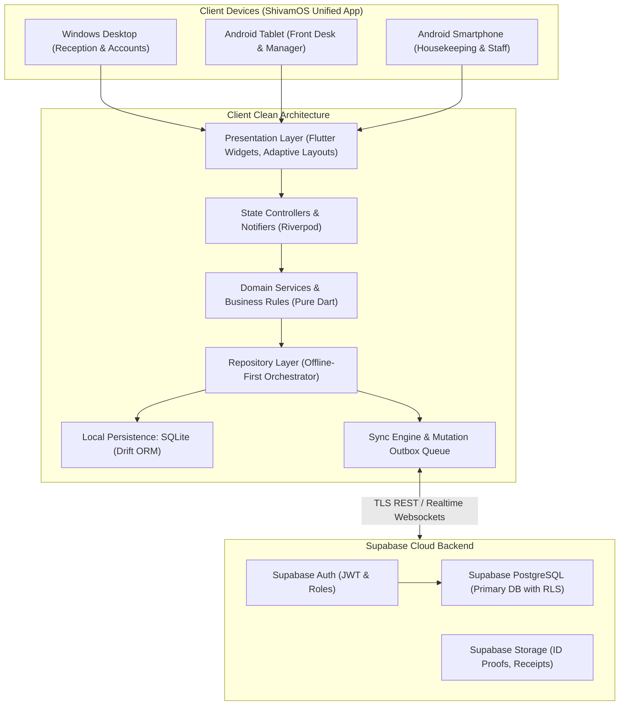
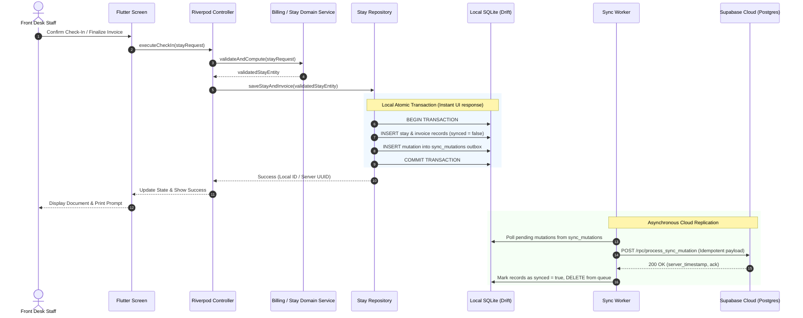

# ShivamOS - System Architecture & Technical Design

**System Name:** ShivamOS  
**Architecture Style:** Clean / Feature-First Architecture with Offline-First Synchronization  
**Platforms:** Windows Desktop, Android Phone & Tablet  
**Frontend Framework:** Flutter 3.x / Dart 3.x  
**Local Database:** SQLite via Drift (Typed SQL & ORM)  
**Cloud Backend:** Supabase (PostgreSQL 15+, Supabase Auth, Row Level Security, Supabase Storage)  
**State Management & DI:** Riverpod 2.x  
**Routing:** GoRouter  

---

## 1. High-Level System Architecture



---

## 2. Layered Software Architecture

Each feature module is structured cleanly into presentation, domain, and data layers:

```
lib/features/<feature_name>/
├── presentation/
│   ├── controllers/      # Riverpod StateNotifier / AsyncNotifier
│   ├── screens/          # Adaptive UI screens (Windows & Android layouts)
│   └── widgets/          # Feature-specific reusable UI components
├── domain/
│   ├── models/           # Immutable Dart domain entities (Freezed / JSON)
│   ├── value_objects/    # Typed value objects (e.g. CurrencyPaise, RoomNumber)
│   └── services/         # Pure domain rules & business calculations
└── data/
    ├── datasources/      # Local Drift queries & Remote Supabase queries
    └── repositories/     # Repository implementation coordinating local & remote
```

### 2.1 Presentation Layer
- **Adaptive Layouts:** Uses responsive builders (`Breakpoints.desktop`, `Breakpoints.tablet`, `Breakpoints.mobile`) to deliver dense, multi-column desktop views with keyboard navigation for Windows, and touch-optimized collapsible lists/bottom sheets for Android.
- **Theme & Design System:** Professional, high-contrast, clutter-free palette (Deep Slate `#1A202C`, Primary Navy `#0F294A`, Accent Amber `#D97706`, Success Emerald `#059669`, Danger Crimson `#DC2626`).
- **No Business Logic in UI:** Widgets only listen to state controllers and dispatch user intents.

### 2.2 Domain Layer
- **Pure Dart:** Completely decoupled from Flutter UI and third-party SDKs.
- **Strict Financial Engine:** All monetary values are represented as integer paise (`int`) to guarantee precision with zero floating-point drift.
- **Business Rule Invariants:** Room occupancy invariants, tax formulas, discount approval thresholds, advance recovery bounds, and salary status transitions are enforced here.

### 2.3 Data Layer
- **Repository Pattern:** Repositories serve as the single source of truth for the domain layer. All queries read from the local Drift SQLite database for instant, zero-latency rendering.
- **Mutation Queue (Outbox Pattern):** Writes are applied to local SQLite immediately and queued in the `sync_mutations` table. The Background Sync Worker processes this queue against Supabase.

---

## 3. Data Flow & Synchronization Lifecycle



---

## 4. Platform Adaptations

### 4.1 Windows Desktop
- **High-Density Data Grids:** Data tables with multi-column sorting, column resizing, filtering, and row actions.
- **Keyboard Accelerators:**
  - `F1`: Global search (guests, rooms, invoices).
  - `F2`: Quick Check-In / Walk-in dialog.
  - `F3`: Quick Checkout.
  - `F5`: Refresh data & sync status.
  - `Ctrl + P`: Direct print invoice / GRC.
- **Direct Printing:** Direct PDF rasterization and Windows spooler integration via native printing channels.

### 4.2 Android Smartphone & Tablet
- **Touch Ergonomics:** Minimum 48dp touch targets, swipe-to-action on housekeeping and room cards.
- **Camera Integration:** Optional capture of guest physical ID proof (Aadhaar / Passport) with secure client-side compression before storage upload.
- **Native Sharing:** Standard Android Sharesheet integration for sending PDF invoices and GRCs to guests via WhatsApp or email.

---

## 5. Security & Boundary Architecture

1. **Client Isolation:** The Flutter client strictly uses the Supabase Anonymous / Authenticated Publishable Key. The `service_role` key is **never** embedded in client binaries.
2. **Backend Enforcement (RLS):** Supabase PostgreSQL Row Level Security checks every single row operation against the authenticated user's JWT `staff_role` and permissions.
3. **Audit Trail:** Any mutation on critical entities (`invoices`, `payments`, `salary_records`, `rooms`) triggers a database-level audit log entry preserving `user_id`, `action`, `old_record`, `new_record`, and `timestamp`.
