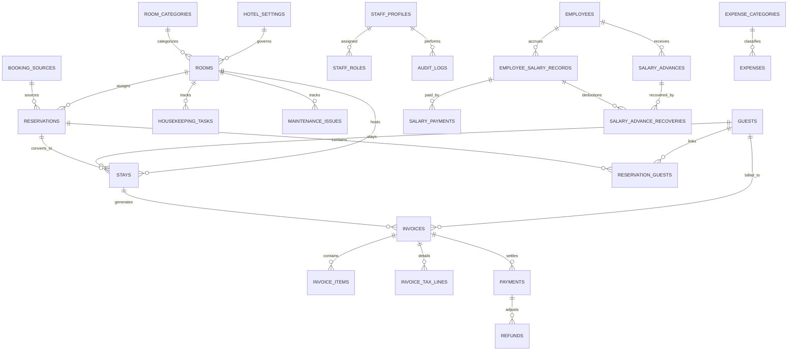

# ShivamOS - Database Schema Specification

**Database Engine:** PostgreSQL 15+ (Supabase) & SQLite 3.39+ (Drift)  
**Schema Architecture:** Fully Normalized, Dual-Tier Relational Schema with Audit Trails and RLS  
**Monetary Representation:** Integer Minor Units (Paise: ₹1.00 = 100 paise)  
**Timezone Standard:** Timestamps stored in UTC (`TIMESTAMPTZ`), rendered in `Asia/Kolkata` (IST, UTC+05:30)  

---

## 1. Entity-Relationship Overview



---

## 2. Table Specifications

### 2.1 Configuration & Core Hotel Settings

#### `hotel_settings`
Singleton table holding hotel-specific branding, regulatory, and policy configurations.
```sql
CREATE TABLE hotel_settings (
    id UUID PRIMARY KEY DEFAULT gen_random_uuid(),
    hotel_name VARCHAR(150) NOT NULL DEFAULT 'Hotel New Shivam Inn',
    tagline VARCHAR(200) DEFAULT 'One Hotel. Every Operation. One System.',
    address_line1 VARCHAR(255) NOT NULL DEFAULT 'B.C. Plaza, opposite Jaandar Shoes & Sanjay Opticals',
    address_line2 VARCHAR(255) DEFAULT 'Motijheel, Muzaffarpur',
    city VARCHAR(100) NOT NULL DEFAULT 'Muzaffarpur',
    state VARCHAR(100) NOT NULL DEFAULT 'Bihar',
    country VARCHAR(100) NOT NULL DEFAULT 'India',
    pincode VARCHAR(20) DEFAULT '842001',
    phone_primary VARCHAR(20) NOT NULL DEFAULT '8235045671',
    phone_secondary VARCHAR(20) DEFAULT '8235045672',
    email VARCHAR(100),
    gstin VARCHAR(15), -- NULL until administrator inputs verified GSTIN
    cgst_rate_percent NUMERIC(5,2) NOT NULL DEFAULT 2.50,
    sgst_rate_percent NUMERIC(5,2) NOT NULL DEFAULT 2.50,
    igst_rate_percent NUMERIC(5,2) NOT NULL DEFAULT 5.00,
    currency_code VARCHAR(10) NOT NULL DEFAULT 'INR',
    currency_symbol VARCHAR(5) NOT NULL DEFAULT '₹',
    timezone VARCHAR(50) NOT NULL DEFAULT 'Asia/Kolkata',
    invoice_prefix VARCHAR(10) NOT NULL DEFAULT 'NSI-',
    next_invoice_number INT NOT NULL DEFAULT 1540, -- Initial sequence configured beyond historical records
    check_in_time_default TIME NOT NULL DEFAULT '12:00:00',
    check_out_time_default TIME NOT NULL DEFAULT '11:00:00',
    invoice_footer_text TEXT DEFAULT 'Thank you for choosing Hotel New Shivam Inn. We hope you enjoyed your stay!',
    created_at TIMESTAMPTZ NOT NULL DEFAULT NOW(),
    updated_at TIMESTAMPTZ NOT NULL DEFAULT NOW()
);
```

---

### 2.2 Room Inventory & Status Tracking

#### `room_categories`
```sql
CREATE TABLE room_categories (
    id UUID PRIMARY KEY DEFAULT gen_random_uuid(),
    name VARCHAR(50) NOT NULL UNIQUE, -- 'Elegant Class', 'Royal Class', 'Corporate Class', 'Suite Room'
    description TEXT,
    base_single_tariff_paise BIGINT NOT NULL CHECK (base_single_tariff_paise >= 0),
    base_double_tariff_paise BIGINT NOT NULL CHECK (base_double_tariff_paise >= 0),
    extra_bed_tariff_paise BIGINT NOT NULL DEFAULT 50000 CHECK (extra_bed_tariff_paise >= 0),
    max_occupancy_adults INT NOT NULL DEFAULT 2 CHECK (max_occupancy_adults >= 1),
    max_occupancy_children INT NOT NULL DEFAULT 1 CHECK (max_occupancy_children >= 0),
    created_at TIMESTAMPTZ NOT NULL DEFAULT NOW(),
    updated_at TIMESTAMPTZ NOT NULL DEFAULT NOW()
);
```

#### `rooms`
```sql
CREATE TABLE rooms (
    id UUID PRIMARY KEY DEFAULT gen_random_uuid(),
    room_number VARCHAR(10) NOT NULL UNIQUE, -- e.g., '201', '304'
    floor_number INT NOT NULL,
    category_id UUID NOT NULL REFERENCES room_categories(id) ON DELETE RESTRICT,
    occupancy_status VARCHAR(20) NOT NULL DEFAULT 'available' 
        CHECK (occupancy_status IN ('available', 'reserved', 'occupied')),
    housekeeping_status VARCHAR(25) NOT NULL DEFAULT 'clean' 
        CHECK (housekeeping_status IN ('clean', 'cleaning_required', 'cleaning_in_progress', 'inspection_required', 'ready')),
    maintenance_status VARCHAR(25) NOT NULL DEFAULT 'normal' 
        CHECK (maintenance_status IN ('normal', 'maintenance_required', 'out_of_service')),
    is_active BOOLEAN NOT NULL DEFAULT true,
    notes TEXT,
    created_at TIMESTAMPTZ NOT NULL DEFAULT NOW(),
    updated_at TIMESTAMPTZ NOT NULL DEFAULT NOW()
);
```

#### `room_status_history`
```sql
CREATE TABLE room_status_history (
    id UUID PRIMARY KEY DEFAULT gen_random_uuid(),
    room_id UUID NOT NULL REFERENCES rooms(id) ON DELETE CASCADE,
    previous_occupancy VARCHAR(20),
    new_occupancy VARCHAR(20),
    previous_housekeeping VARCHAR(25),
    new_housekeeping VARCHAR(25),
    previous_maintenance VARCHAR(25),
    new_maintenance VARCHAR(25),
    reason TEXT,
    changed_by_profile_id UUID REFERENCES auth.users(id),
    created_at TIMESTAMPTZ NOT NULL DEFAULT NOW()
);
```

---

### 2.3 Guest Management & Digital Registration Cards

#### `guests`
```sql
CREATE TABLE guests (
    id UUID PRIMARY KEY DEFAULT gen_random_uuid(),
    full_name VARCHAR(150) NOT NULL,
    phone VARCHAR(20) NOT NULL,
    email VARCHAR(100),
    address_street VARCHAR(255),
    city VARCHAR(100),
    state VARCHAR(100),
    country VARCHAR(100) DEFAULT 'India',
    pincode VARCHAR(20),
    company_name VARCHAR(150),
    designation VARCHAR(100),
    company_gstin VARCHAR(15),
    id_proof_type VARCHAR(50) CHECK (id_proof_type IN ('aadhaar', 'passport', 'voter_id', 'driving_license', 'other')),
    id_proof_number VARCHAR(100),
    id_proof_document_url TEXT,
    is_foreign_national BOOLEAN NOT NULL DEFAULT false,
    passport_number VARCHAR(50),
    passport_expiry DATE,
    visa_number VARCHAR(50),
    visa_expiry DATE,
    nationality VARCHAR(100) DEFAULT 'Indian',
    vip_status BOOLEAN NOT NULL DEFAULT false,
    restricted_admin_notes TEXT,
    created_at TIMESTAMPTZ NOT NULL DEFAULT NOW(),
    updated_at TIMESTAMPTZ NOT NULL DEFAULT NOW()
);
CREATE INDEX idx_guests_phone ON guests(phone);
CREATE INDEX idx_guests_name ON guests(full_name);
```

---

### 2.4 Reservations & Stays

#### `booking_sources`
```sql
CREATE TABLE booking_sources (
    id UUID PRIMARY KEY DEFAULT gen_random_uuid(),
    name VARCHAR(50) NOT NULL UNIQUE, -- 'Walk-in', 'Telephone', 'WhatsApp', 'Direct Website', 'MakeMyTrip', 'Goibibo', 'Booking.com', 'Agoda'
    is_ota BOOLEAN NOT NULL DEFAULT false,
    commission_percentage NUMERIC(5,2) DEFAULT 0.00,
    is_active BOOLEAN NOT NULL DEFAULT true,
    created_at TIMESTAMPTZ NOT NULL DEFAULT NOW()
);
```

#### `reservations`
```sql
CREATE TABLE reservations (
    id UUID PRIMARY KEY DEFAULT gen_random_uuid(),
    reservation_code VARCHAR(20) NOT NULL UNIQUE, -- e.g., 'RES-202610-001'
    primary_guest_id UUID NOT NULL REFERENCES guests(id) ON DELETE RESTRICT,
    booking_source_id UUID NOT NULL REFERENCES booking_sources(id) ON DELETE RESTRICT,
    external_booking_reference VARCHAR(100), -- OTA booking ID
    category_id UUID NOT NULL REFERENCES room_categories(id) ON DELETE RESTRICT,
    assigned_room_id UUID REFERENCES rooms(id) ON DELETE SET NULL,
    check_in_date DATE NOT NULL,
    check_out_date DATE NOT NULL CHECK (check_out_date > check_in_date),
    expected_arrival_time TIME,
    expected_departure_time TIME,
    occupancy_type VARCHAR(10) NOT NULL DEFAULT 'double' CHECK (occupancy_type IN ('single', 'double')),
    adults_count INT NOT NULL DEFAULT 1 CHECK (adults_count >= 1),
    children_count INT NOT NULL DEFAULT 0 CHECK (children_count >= 0),
    agreed_nightly_tariff_paise BIGINT NOT NULL CHECK (agreed_nightly_tariff_paise >= 0),
    advance_amount_paid_paise BIGINT NOT NULL DEFAULT 0 CHECK (advance_amount_paid_paise >= 0),
    status VARCHAR(20) NOT NULL DEFAULT 'confirmed' 
        CHECK (status IN ('pending', 'confirmed', 'checked_in', 'checked_out', 'cancelled', 'no_show')),
    special_requests TEXT,
    cancellation_reason TEXT,
    cancelled_at TIMESTAMPTZ,
    created_by_profile_id UUID REFERENCES auth.users(id),
    created_at TIMESTAMPTZ NOT NULL DEFAULT NOW(),
    updated_at TIMESTAMPTZ NOT NULL DEFAULT NOW()
);
CREATE INDEX idx_reservations_dates ON reservations(check_in_date, check_out_date);
CREATE INDEX idx_reservations_room ON reservations(assigned_room_id);
```

#### `stays` (Active/Completed Checked-In Stays)
```sql
CREATE TABLE stays (
    id UUID PRIMARY KEY DEFAULT gen_random_uuid(),
    stay_code VARCHAR(20) NOT NULL UNIQUE, -- 'STY-202610-001'
    reservation_id UUID REFERENCES reservations(id) ON DELETE SET NULL,
    guest_id UUID NOT NULL REFERENCES guests(id) ON DELETE RESTRICT,
    room_id UUID NOT NULL REFERENCES rooms(id) ON DELETE RESTRICT,
    category_id UUID NOT NULL REFERENCES room_categories(id) ON DELETE RESTRICT,
    actual_check_in_time TIMESTAMPTZ NOT NULL DEFAULT NOW(),
    actual_check_out_time TIMESTAMPTZ,
    expected_check_out_date DATE NOT NULL,
    occupancy_type VARCHAR(10) NOT NULL DEFAULT 'double' CHECK (occupancy_type IN ('single', 'double')),
    adults_count INT NOT NULL DEFAULT 1 CHECK (adults_count >= 1),
    children_count INT NOT NULL DEFAULT 0 CHECK (children_count >= 0),
    applied_nightly_tariff_paise BIGINT NOT NULL CHECK (applied_nightly_tariff_paise >= 0),
    purpose_of_visit VARCHAR(150),
    status VARCHAR(20) NOT NULL DEFAULT 'active' CHECK (status IN ('active', 'completed')),
    grc_pdf_url TEXT,
    receptionist_profile_id UUID REFERENCES auth.users(id),
    created_at TIMESTAMPTZ NOT NULL DEFAULT NOW(),
    updated_at TIMESTAMPTZ NOT NULL DEFAULT NOW(),
    -- Enforce that a room cannot have more than one active stay simultaneously
    CONSTRAINT unique_active_room_stay UNIQUE (room_id, status)
);
```

---

### 2.5 Invoices, Billing & Payments

#### `invoices`
```sql
CREATE TABLE invoices (
    id UUID PRIMARY KEY DEFAULT gen_random_uuid(),
    invoice_number VARCHAR(50) NOT NULL UNIQUE, -- e.g., 'NSI-1540'
    stay_id UUID REFERENCES stays(id) ON DELETE SET NULL,
    guest_id UUID NOT NULL REFERENCES guests(id) ON DELETE RESTRICT,
    invoice_date DATE NOT NULL DEFAULT CURRENT_DATE,
    billable_nights INT NOT NULL CHECK (billable_nights >= 1),
    room_charges_paise BIGINT NOT NULL CHECK (room_charges_paise >= 0),
    extra_charges_paise BIGINT NOT NULL DEFAULT 0 CHECK (extra_charges_paise >= 0),
    subtotal_paise BIGINT NOT NULL CHECK (subtotal_paise >= 0),
    discount_percentage NUMERIC(5,2) NOT NULL DEFAULT 0.00 CHECK (discount_percentage >= 0 AND discount_percentage <= 100),
    discount_amount_paise BIGINT NOT NULL DEFAULT 0 CHECK (discount_amount_paise >= 0),
    taxable_amount_paise BIGINT NOT NULL CHECK (taxable_amount_paise >= 0),
    cgst_rate_percent NUMERIC(5,2) NOT NULL DEFAULT 2.50,
    cgst_amount_paise BIGINT NOT NULL DEFAULT 0 CHECK (cgst_amount_paise >= 0),
    sgst_rate_percent NUMERIC(5,2) NOT NULL DEFAULT 2.50,
    sgst_amount_paise BIGINT NOT NULL DEFAULT 0 CHECK (sgst_amount_paise >= 0),
    igst_rate_percent NUMERIC(5,2) NOT NULL DEFAULT 0.00,
    igst_amount_paise BIGINT NOT NULL DEFAULT 0 CHECK (igst_amount_paise >= 0),
    total_tax_paise BIGINT NOT NULL DEFAULT 0 CHECK (total_tax_paise >= 0),
    total_amount_paise BIGINT NOT NULL CHECK (total_amount_paise >= 0),
    total_paid_paise BIGINT NOT NULL DEFAULT 0 CHECK (total_paid_paise >= 0),
    outstanding_balance_paise BIGINT NOT NULL DEFAULT 0 CHECK (outstanding_balance_paise >= 0),
    status VARCHAR(20) NOT NULL DEFAULT 'draft' 
        CHECK (status IN ('draft', 'finalized', 'paid', 'partially_paid', 'cancelled', 'refunded')),
    amount_in_words TEXT NOT NULL,
    notes TEXT,
    is_locked BOOLEAN NOT NULL DEFAULT false, -- Locked once finalized; cannot be modified directly
    created_by_profile_id UUID REFERENCES auth.users(id),
    created_at TIMESTAMPTZ NOT NULL DEFAULT NOW(),
    updated_at TIMESTAMPTZ NOT NULL DEFAULT NOW()
);
```

#### `payments`
```sql
CREATE TABLE payments (
    id UUID PRIMARY KEY DEFAULT gen_random_uuid(),
    payment_reference VARCHAR(50) NOT NULL UNIQUE,
    invoice_id UUID REFERENCES invoices(id) ON DELETE CASCADE,
    reservation_id UUID REFERENCES reservations(id) ON DELETE SET NULL,
    stay_id UUID REFERENCES stays(id) ON DELETE SET NULL,
    amount_paise BIGINT NOT NULL CHECK (amount_paise > 0),
    payment_method VARCHAR(30) NOT NULL CHECK (payment_method IN ('cash', 'upi', 'card', 'bank_transfer', 'other')),
    transaction_id VARCHAR(100), -- UPI Ref / Bank UTR / Card Auth Code
    payment_type VARCHAR(20) NOT NULL CHECK (payment_type IN ('advance', 'stay_settlement', 'post_checkout')),
    paid_at TIMESTAMPTZ NOT NULL DEFAULT NOW(),
    received_by_profile_id UUID REFERENCES auth.users(id),
    notes TEXT,
    created_at TIMESTAMPTZ NOT NULL DEFAULT NOW()
);
```

#### `refunds`
```sql
CREATE TABLE refunds (
    id UUID PRIMARY KEY DEFAULT gen_random_uuid(),
    refund_reference VARCHAR(50) NOT NULL UNIQUE,
    payment_id UUID NOT NULL REFERENCES payments(id) ON DELETE RESTRICT,
    invoice_id UUID NOT NULL REFERENCES invoices(id) ON DELETE RESTRICT,
    amount_paise BIGINT NOT NULL CHECK (amount_paise > 0),
    refund_method VARCHAR(30) NOT NULL CHECK (refund_method IN ('cash', 'upi', 'bank_transfer', 'original_mode')),
    reason TEXT NOT NULL,
    authorized_by_profile_id UUID NOT NULL REFERENCES auth.users(id),
    refunded_at TIMESTAMPTZ NOT NULL DEFAULT NOW(),
    created_at TIMESTAMPTZ NOT NULL DEFAULT NOW()
);
```

---

### 2.6 Employee Payroll & Salary Advances

#### `employees`
```sql
CREATE TABLE employees (
    id UUID PRIMARY KEY DEFAULT gen_random_uuid(),
    employee_code VARCHAR(20) NOT NULL UNIQUE, -- 'EMP-001'
    full_name VARCHAR(150) NOT NULL,
    mobile VARCHAR(20) NOT NULL,
    designation VARCHAR(100) NOT NULL, -- 'Manager', 'Receptionist', 'Housekeeping', 'Security', etc.
    department VARCHAR(50) NOT NULL DEFAULT 'General',
    joining_date DATE NOT NULL,
    base_monthly_salary_paise BIGINT NOT NULL CHECK (base_monthly_salary_paise >= 0),
    salary_due_day INT NOT NULL DEFAULT 5 CHECK (salary_due_day >= 1 AND salary_due_day <= 28),
    is_active BOOLEAN NOT NULL DEFAULT true,
    notes TEXT,
    created_at TIMESTAMPTZ NOT NULL DEFAULT NOW(),
    updated_at TIMESTAMPTZ NOT NULL DEFAULT NOW()
);
```

#### `employee_salary_records`
```sql
CREATE TABLE employee_salary_records (
    id UUID PRIMARY KEY DEFAULT gen_random_uuid(),
    employee_id UUID NOT NULL REFERENCES employees(id) ON DELETE RESTRICT,
    salary_month VARCHAR(7) NOT NULL, -- 'YYYY-MM', e.g., '2026-10'
    base_salary_paise BIGINT NOT NULL CHECK (base_salary_paise >= 0),
    additional_earnings_paise BIGINT NOT NULL DEFAULT 0 CHECK (additional_earnings_paise >= 0),
    deductions_paise BIGINT NOT NULL DEFAULT 0 CHECK (deductions_paise >= 0),
    gross_salary_paise BIGINT NOT NULL CHECK (gross_salary_paise >= 0),
    advance_recovered_paise BIGINT NOT NULL DEFAULT 0 CHECK (advance_recovered_paise >= 0),
    net_salary_payable_paise BIGINT NOT NULL CHECK (net_salary_payable_paise >= 0),
    amount_paid_paise BIGINT NOT NULL DEFAULT 0 CHECK (amount_paid_paise >= 0),
    outstanding_balance_paise BIGINT NOT NULL CHECK (outstanding_balance_paise >= 0),
    due_date DATE NOT NULL,
    status VARCHAR(20) NOT NULL DEFAULT 'salary_due' 
        CHECK (status IN ('salary_due', 'partially_paid', 'paid', 'overdue')),
    notes TEXT,
    created_at TIMESTAMPTZ NOT NULL DEFAULT NOW(),
    updated_at TIMESTAMPTZ NOT NULL DEFAULT NOW(),
    CONSTRAINT unique_employee_salary_month UNIQUE (employee_id, salary_month)
);
```

#### `salary_advances`
```sql
CREATE TABLE salary_advances (
    id UUID PRIMARY KEY DEFAULT gen_random_uuid(),
    advance_code VARCHAR(20) NOT NULL UNIQUE, -- 'ADV-202610-001'
    employee_id UUID NOT NULL REFERENCES employees(id) ON DELETE RESTRICT,
    advance_date DATE NOT NULL DEFAULT CURRENT_DATE,
    amount_paise BIGINT NOT NULL CHECK (amount_paise > 0),
    recovered_amount_paise BIGINT NOT NULL DEFAULT 0 CHECK (recovered_amount_paise >= 0),
    outstanding_balance_paise BIGINT NOT NULL CHECK (outstanding_balance_paise >= 0),
    reason TEXT,
    status VARCHAR(20) NOT NULL DEFAULT 'active' CHECK (status IN ('active', 'partially_recovered', 'fully_recovered')),
    approved_by_profile_id UUID REFERENCES auth.users(id),
    created_at TIMESTAMPTZ NOT NULL DEFAULT NOW(),
    updated_at TIMESTAMPTZ NOT NULL DEFAULT NOW(),
    CONSTRAINT check_advance_recovery_bound CHECK (recovered_amount_paise <= amount_paise)
);
```

#### `salary_advance_recoveries`
```sql
CREATE TABLE salary_advance_recoveries (
    id UUID PRIMARY KEY DEFAULT gen_random_uuid(),
    salary_record_id UUID NOT NULL REFERENCES employee_salary_records(id) ON DELETE RESTRICT,
    advance_id UUID NOT NULL REFERENCES salary_advances(id) ON DELETE RESTRICT,
    recovered_paise BIGINT NOT NULL CHECK (recovered_paise > 0),
    recovered_at TIMESTAMPTZ NOT NULL DEFAULT NOW()
);
```

#### `salary_payments`
```sql
CREATE TABLE salary_payments (
    id UUID PRIMARY KEY DEFAULT gen_random_uuid(),
    salary_record_id UUID NOT NULL REFERENCES employee_salary_records(id) ON DELETE CASCADE,
    amount_paise BIGINT NOT NULL CHECK (amount_paise > 0),
    payment_method VARCHAR(30) NOT NULL CHECK (payment_method IN ('cash', 'upi', 'bank_transfer')),
    reference_number VARCHAR(100),
    paid_at TIMESTAMPTZ NOT NULL DEFAULT NOW(),
    paid_by_profile_id UUID REFERENCES auth.users(id),
    notes TEXT,
    created_at TIMESTAMPTZ NOT NULL DEFAULT NOW()
);
```

---

### 2.7 Housekeeping, Maintenance & Expenses

#### `housekeeping_tasks`
```sql
CREATE TABLE housekeeping_tasks (
    id UUID PRIMARY KEY DEFAULT gen_random_uuid(),
    room_id UUID NOT NULL REFERENCES rooms(id) ON DELETE CASCADE,
    assigned_employee_id UUID REFERENCES employees(id) ON DELETE SET NULL,
    task_type VARCHAR(30) NOT NULL DEFAULT 'turnover_clean' CHECK (task_type IN ('turnover_clean', 'daily_tidy', 'deep_clean', 'linen_change')),
    status VARCHAR(25) NOT NULL DEFAULT 'cleaning_required' CHECK (status IN ('cleaning_required', 'cleaning_in_progress', 'inspection_required', 'completed')),
    priority VARCHAR(15) NOT NULL DEFAULT 'normal' CHECK (priority IN ('low', 'normal', 'high', 'urgent')),
    started_at TIMESTAMPTZ,
    completed_at TIMESTAMPTZ,
    notes TEXT,
    created_at TIMESTAMPTZ NOT NULL DEFAULT NOW()
);
```

#### `maintenance_issues`
```sql
CREATE TABLE maintenance_issues (
    id UUID PRIMARY KEY DEFAULT gen_random_uuid(),
    room_id UUID REFERENCES rooms(id) ON DELETE CASCADE,
    reported_by_profile_id UUID REFERENCES auth.users(id),
    title VARCHAR(150) NOT NULL,
    description TEXT NOT NULL,
    priority VARCHAR(15) NOT NULL DEFAULT 'medium' CHECK (priority IN ('low', 'medium', 'high', 'emergency')),
    status VARCHAR(20) NOT NULL DEFAULT 'open' CHECK (status IN ('open', 'in_progress', 'resolved', 'cancelled')),
    resolution_notes TEXT,
    resolved_at TIMESTAMPTZ,
    created_at TIMESTAMPTZ NOT NULL DEFAULT NOW()
);
```

#### `expense_categories`
```sql
CREATE TABLE expense_categories (
    id UUID PRIMARY KEY DEFAULT gen_random_uuid(),
    name VARCHAR(100) NOT NULL UNIQUE, -- 'Utilities', 'Housekeeping Supplies', 'Maintenance & Repairs', 'Staff Welfare', 'Miscellaneous'
    created_at TIMESTAMPTZ NOT NULL DEFAULT NOW()
);
```

#### `expenses`
```sql
CREATE TABLE expenses (
    id UUID PRIMARY KEY DEFAULT gen_random_uuid(),
    expense_reference VARCHAR(50) NOT NULL UNIQUE,
    category_id UUID NOT NULL REFERENCES expense_categories(id) ON DELETE RESTRICT,
    expense_date DATE NOT NULL DEFAULT CURRENT_DATE,
    amount_paise BIGINT NOT NULL CHECK (amount_paise > 0),
    payment_method VARCHAR(30) NOT NULL CHECK (payment_method IN ('cash', 'upi', 'bank_transfer', 'card')),
    description TEXT NOT NULL,
    receipt_document_url TEXT,
    recorded_by_profile_id UUID REFERENCES auth.users(id),
    notes TEXT,
    created_at TIMESTAMPTZ NOT NULL DEFAULT NOW()
);
```

---

### 2.8 Audit Logging & Synchronization Queue

#### `audit_logs`
```sql
CREATE TABLE audit_logs (
    id UUID PRIMARY KEY DEFAULT gen_random_uuid(),
    actor_id UUID REFERENCES auth.users(id),
    actor_email VARCHAR(100),
    action VARCHAR(50) NOT NULL, -- e.g., 'INVOICE_FINALIZED', 'DISCOUNT_APPROVED', 'SALARY_PAID'
    entity_name VARCHAR(50) NOT NULL,
    entity_id VARCHAR(100) NOT NULL,
    changes JSONB,
    client_ip VARCHAR(50),
    created_at TIMESTAMPTZ NOT NULL DEFAULT NOW()
);
```

#### `sync_mutations` (Local SQLite Outbox Table)
```sql
CREATE TABLE sync_mutations (
    id TEXT PRIMARY KEY, -- Client-generated UUID
    table_name TEXT NOT NULL,
    operation TEXT NOT NULL CHECK (operation IN ('INSERT', 'UPDATE', 'DELETE')),
    record_id TEXT NOT NULL,
    payload_json TEXT NOT NULL,
    created_at TEXT NOT NULL,
    retry_count INTEGER NOT NULL DEFAULT 0,
    last_error TEXT,
    status TEXT NOT NULL DEFAULT 'pending' CHECK (status IN ('pending', 'syncing', 'failed'))
);
```
