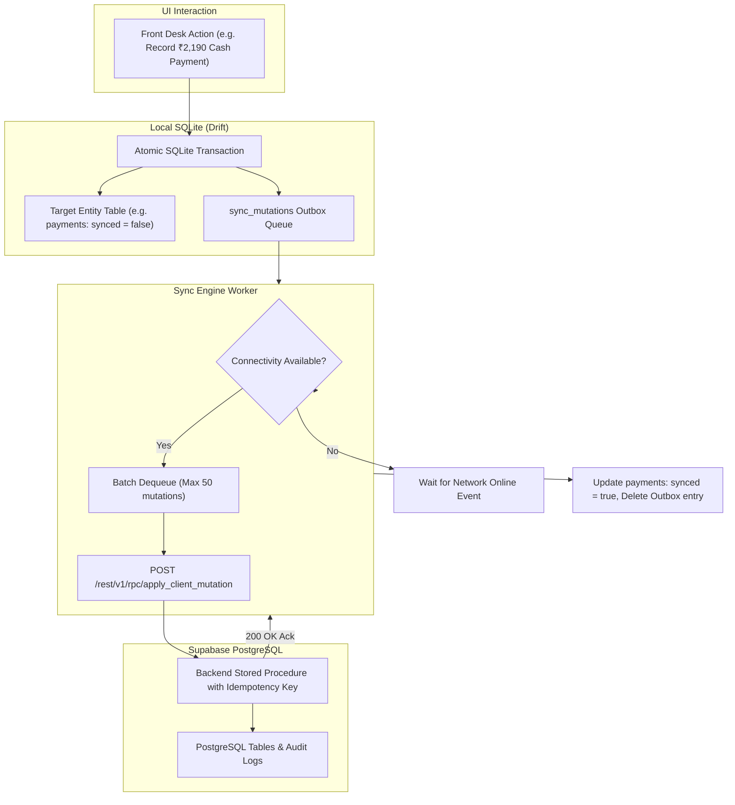

# ShivamOS - Synchronization & Offline-First Strategy

**Target System:** ShivamOS  
**Local Database:** Drift (SQLite 3.39+) on Windows & Android  
**Cloud Backend:** Supabase PostgreSQL 15+  
**Pattern:** Transactional Outbox Pattern with Idempotent Replays & Conflict Detection  

---

## 1. Offline-First Design Rationale

In Muzaffarpur, Bihar, broadband or cellular connectivity at the reception desk may experience temporary disruptions, power fluctuations, or ISP outages. A reception desk cannot freeze guest check-in, key handover, or checkout printing while waiting for cloud latency or reconnecting to Wi-Fi.

**Core Philosophy:** 
1. **Local-First Writes:** Every operational event (guest registration, check-in, bill calculation, invoice printing, payment collection, housekeeping update) is committed to the local SQLite database inside an immediate atomic transaction.
2. **Instant UI Response:** The user never waits on a network spinner for standard operations.
3. **Guaranteed Cloud Convergence:** When connectivity is restored, the synchronization engine replays queued mutations to Supabase in strict causal order.

---

## 2. Synchronization Architecture & Outbox Pattern

---

## 3. Durability & Recovery Across Restarts

1. **Persistent SQLite Outbox:** The `sync_mutations` table lives in non-volatile SQLite database storage on the device's persistent filesystem (e.g., `%APPDATA%\ShivamOS\app.db` on Windows, `/data/user/0/com.shivamos.app/databases/app.db` on Android).
2. **Crash Resilience:** If the application process crashes, the device loses power, or the user closes the app, all pending mutations remain securely saved on disk.
3. **Resumption on Startup:** The Sync Worker launches automatically when the application starts, queries `sync_mutations WHERE status != 'syncing'`, and resumes syncing.

---

## 4. Conflict Resolution Matrix

| Entity Type | Conflict Scenario | Resolution Policy | Safeguard / Action |
| :--- | :--- | :--- | :--- |
| **Room Housekeeping State** | Attendant marks room `Clean` offline, Reception marks `Inspection Required` online. | **Last Write Wins (LWW)** based on newer timestamp. | Updates room board immediately; operational risk is low. |
| **Room Occupancy & Stays** | Two offline devices allocate Room 201 for the same night. | **First Synced Wins** at database constraint level. | The second conflicting stay is flagged in the **Booking Reconciliation Queue** with status `ROOM_CONFLICT`. The staff is prompted to reassign to another room in the same category without dropping the guest record. |
| **Invoices & Billing** | Device A finalizes invoice offline; Device B attempts modification online. | **Strict Immutability & Rejection.** | Once an invoice is finalized on the server, subsequent modifications are rejected. Corrections must be handled via a Credit Note or Adjustment. |
| **Payments** | Intermittent connection causes client to resend payment payload. | **Strict Idempotency via UUID.** | The backend checks `payment_reference`. If it already exists, the server returns `200 OK (already_processed)` without double-crediting. |
| **Salary Advances & Payroll** | Advance recorded offline while another manager records advance. | **Additive Append-Only Ledger.** | Advances are recorded as separate rows. Outstanding balance is computed as the sum of all active advances minus sum of recoveries. |

---

## 5. Exponential Backoff & Fault Tolerance

When network calls fail due to HTTP 5xx, timeout, or DNS resolution failure:
1. `retry_count` is incremented.
2. Backoff duration follows:
   $$T_{\text{wait}} = \min(60\text{s}, 2^{\text{retry\_count}} \times 1\text{s}) + \text{jitter}(0, 500\text{ms})$$
3. UI displays a clear synchronization badge:
   - 🟢 **Synced:** All local mutations replicated to Supabase.
   - 🟡 **Syncing (X pending):** Replicating local operations.
   - 🔴 **Offline:** Device disconnected; operations safe locally.
   - ⚠️ **Action Required:** A booking conflict needs staff review in Reconciliation.
