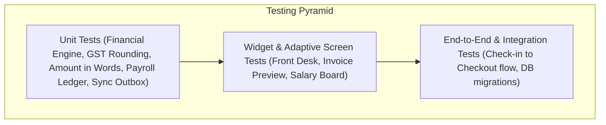

# ShivamOS - Quality Assurance & Automated Test Plan

**Target System:** ShivamOS  
**Test Frameworks:** Dart `test`, Flutter `flutter_test`, Integration Testing `integration_test`  
**Test Coverage Target:** 100% on Core Financial, Payroll, Room Invariants, and Sync Engine  

---

## 1. Test Architecture & Pyramids



---

## 2. Unit Test Matrix

### 2.1 Financial & Billing Engine Unit Tests
| Test Case ID | Test Description | Input Data | Expected Result |
| :--- | :--- | :--- | :--- |
| `TC-FIN-01` | Elegant Class Single Occupancy (1 night) | Category: Elegant, Single, 1 night | Gross: ₹1,890.00 (`189000` p), CGST 2.5%: ₹47.25 $\rightarrow$ ₹47 (`4725` p), SGST 2.5%: ₹47.25 $\rightarrow$ ₹47 (`4725` p), Total: ₹1,984.50 $\rightarrow$ `198450` p |
| `TC-FIN-02` | Elegant Class Double Occupancy (3 nights) with 10% Discount | Category: Elegant, Double, 3 nights, 10% discount | Base: ₹6,570.00 (`657000` p), Discount 10%: ₹657.00 (`65700` p), Taxable: ₹5,913.00 (`591300` p), Combined GST 5%: ₹295.65 (`29565` p), Total: ₹6,208.65 (`620865` p) |
| `TC-FIN-03` | Royal Class Single & Double Occupancy | Royal Single (₹2,200), Royal Double (₹2,490) | Exact tariffs applied without cross-category contamination |
| `TC-FIN-04` | Corporate Class Single & Double Occupancy | Corporate Single (₹2,700), Corporate Double (₹3,390) | Exact tariffs applied |
| `TC-FIN-05` | Suite Room Single & Double Occupancy | Suite Single (₹4,500), Suite Double (₹5,500) | Exact tariffs applied |
| `TC-FIN-06` | Same-Day Day-Use Billable Nights | Check-in: 10:00 AM, Checkout: 5:00 PM same day | Calculated billable nights clamped to minimum 1 night |
| `TC-FIN-07` | Partial Payments & Outstanding Balance | Total: ₹5,000.00, Advance: ₹2,000.00, Settlement: ₹1,500.00 | Total paid: ₹3,500.00, Outstanding: ₹1,500.00, Status: `partially_paid` |
| `TC-FIN-08` | Indian Currency in Words Generation | `paise = 219000` | "Rupees Two Thousand One Hundred Ninety and Paise Zero Only" |
| `TC-FIN-09` | Indian Currency with Lakhs and Paise | `paise = 12543075` | "Rupees One Lakh Twenty Five Thousand Four Hundred Thirty and Paise Seventy Five Only" |

### 2.2 Room Inventory & Overlap Prevention Tests
| Test Case ID | Test Description | Input Condition | Expected Result |
| :--- | :--- | :--- | :--- |
| `TC-ROOM-01` | Confirmed 9 Elegant Class Initialization | Room list query on fresh install | Rooms 201, 204, 205, 301, 304, 305, 401, 404, 405 initialized active with Elegant tariffs |
| `TC-ROOM-02` | Prevent Overlapping Stays on Same Room | Room 201 already occupied (`status: active`) | Attempting new stay on 201 throws `RoomUnavailableException` |
| `TC-ROOM-03` | Orthogonal Status Validation | Guest checks out of Room 301 | Occupancy becomes `available`, Housekeeping becomes `cleaning_required`. Room blocked from check-in until cleaned. |
| `TC-ROOM-04` | Out of Service Blocking | Room 401 marked `out_of_service` | Room is unselectable in Check-in and Reservation pickers |

### 2.3 Payroll & Advance Ledger Tests
| Test Case ID | Test Description | Scenario | Expected Result |
| :--- | :--- | :--- | :--- |
| `TC-PAY-01` | Advance Issuance & Balance Increment | Employee base ₹18,000. Issue ₹5,000 advance. | Advance recorded (`500000` p). Employee advance balance = ₹5,000. Cash outflow logged. |
| `TC-PAY-02` | Salary Generation with Partial Advance Recovery | Monthly salary processed with ₹3,000 advance deduction | Gross: ₹18,000, Advance Recovery: ₹3,000, Net Payable: ₹15,000. Remaining advance balance = ₹2,000. No double-counting. |
| `TC-PAY-03` | Prevention of Over-Recovery | Advance balance ₹2,000. User attempts ₹3,000 recovery. | Throws `AdvanceOverRecoveryException`. Recovery capped at ₹2,000. |
| `TC-PAY-04` | Due Date & Overdue Status Evaluation | Due day: 5th. Today: 10th. Unpaid. | Status transitions to `overdue`. |
| `TC-PAY-05` | Multiple Installment Salary Payments | Net: ₹15,000. Pay ₹8,000 on 5th, ₹7,000 on 12th. | 1st payment: Status `partially_paid`, balance ₹7,000. 2nd payment: Status `paid`, balance ₹0. |

### 2.4 Online Booking & Sync Outbox Tests
| Test Case ID | Test Description | Scenario | Expected Result |
| :--- | :--- | :--- | :--- |
| `TC-SYNC-01` | Outbox Insertion on Offline Action | Airplane mode. Check in walk-in guest. | Stay inserted in local SQLite. Entry created in `sync_mutations` with `status = pending`. |
| `TC-SYNC-02` | Durable Persistence Across Restart | Process killed and restarted while 3 mutations pending. | Sync worker restarts, queries 3 pending mutations, successfully resumes. |
| `TC-SYNC-03` | OTA Idempotency Key Dedup | Ingest MMT reservation with ref `MMT-98765` twice. | Second ingestion rejected with `DuplicateBookingReferenceException`. |

---

## 3. Test Execution Commands

```bash
# Run all unit tests
flutter test

# Run tests with coverage report
flutter test --coverage

# Run specific domain test suites
flutter test test/features/billing/billing_engine_test.dart
flutter test test/features/rooms/room_inventory_test.dart
flutter test test/features/salaries/payroll_ledger_test.dart
flutter test test/features/sync/sync_outbox_test.dart
```
